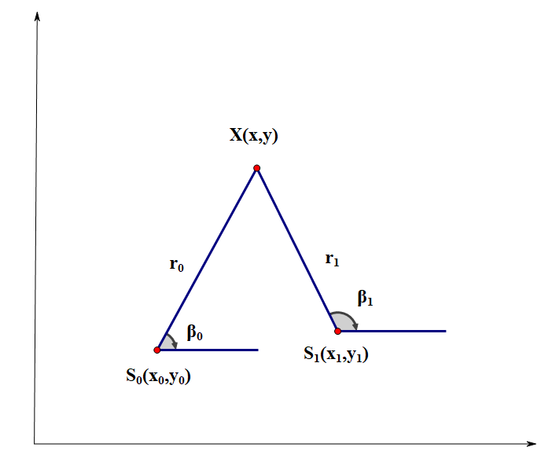
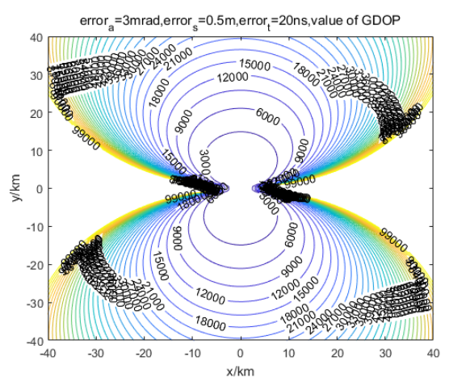
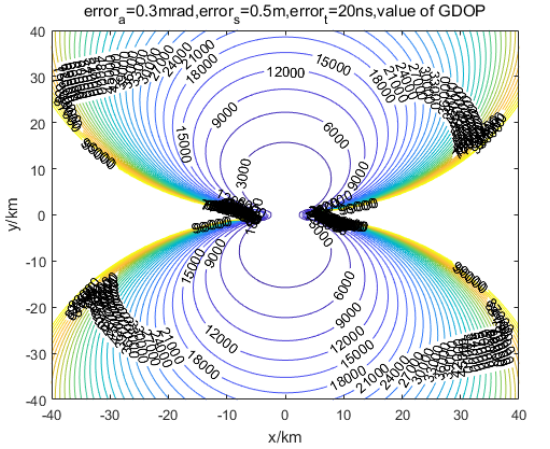
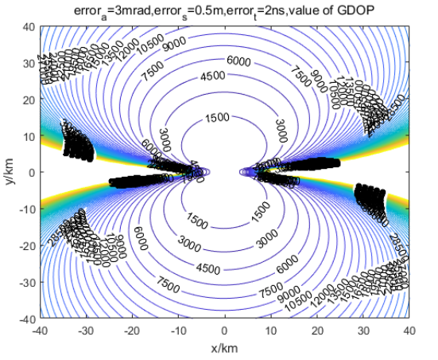
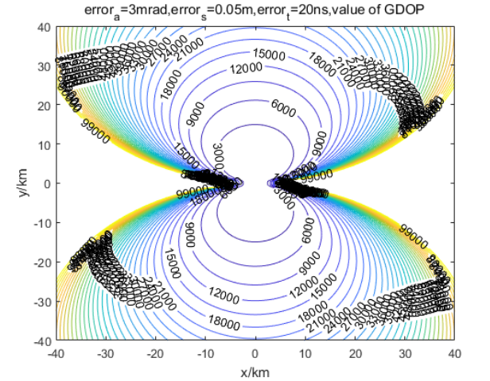
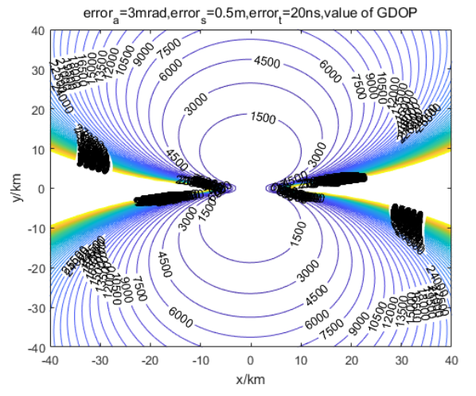

# [Direction Finding]Principles and Simulation of Two-Site Directional Time Difference Positioning[with MATLAB Code]

1. Two-station directional difference positioning 1.1 Positioning algorithm diagram of two-station directional difference positioning is as follows:
(Schematic diagram: includes target points, two base stations (marked as), and distance from the target to both base stations)
The coordinates of two base stations are and. The propagation speed of the signal is, The time difference of the target signal measured by the two base stations is, The horizontal angles between the target and two base stations are respectively and. Determine the coordinates of the target through these known data.
Core Formula 1
Target to two base station distance:
1  
Time difference equation:
1  
Angle equation:
Solve the equation set by simplifying the time-delay equations and combining them with the first angle equation into a system of equations.
The final coordinates of the target can be obtained.
1.2 Analysis of positioning precision and the derivation of differential equations 1
Differentiate the first angle equation on both sides and simplify:
1  
Differentiate the distance difference equation and simplify:
Matrix equations and error matrices transform the above differential equation into a matrix equation form, where:
Furthermore, the error matrix of the target is further deduced as follows:
Related parameter definitions•
Measurement parameter error matrix.
•  
- Position error matrix of the base station.
•  
- Position error matrix of the base station.
•  
Root-mean-square error.
•  
Root Mean Square Error.
•  
Root mean square error.
•  
Geometric precision factor:
1.3 Basic Parameters for Simulation Analysis Settings•
Base station coordinates:
•  
Root Mean Square Error:
•  
Root Mean Square Error:
•  
Root Mean Square Error:
Basic simulation results
(Simulation diagram: Mark "error_=3mrad, error=0.5m, error:=20ns, GDOP value", x-axis unit is km, range includes -20 to 30 intervals)
Coordinates /m
GDOP/m  
(0,10000)  
1352.5  
(3500,5000)  
729.2783  
Variable Optimization Simulation 1
The root mean square error is reduced to 0.3mrad
•  
Simulation conditions: Root mean square error of angle, time difference, and position.
•  
(Simulation diagram: Mark "error.=0.3mrad, error:=0.5m. error:=20ns, value of GDOP", x-axis unit is km, range includes -30 to 30 intervals)
•  
Results Table:
Coordinates /m
GDOP/m  
(0,10000)  
1212.9  
(3500,5000)  
671.3681  
1  
The root mean square error of time difference is reduced to 2ns.
•  
Simulation conditions: Root mean square error of angle, time difference, and position.
•  
(Simulation diagram: annotated with "error 3mra, error .0-.mror2mnu", x-axis unit is km, range includes -30 to 10 intervals)
•  
Results Table:
Coordinates /m
GDOP/m  
(0,10000)  
629.6624  
(3500,5000)  
304.2796  
1  
The root mean square error is reduced to 0.05m
•  
Simulation conditions: Root mean square error of angle, time difference, and position.
•  
(Simulation diagram: Mark "error =3mrad.error,=0.05m,error,=20ns,value of GDOP", x-axis unit is km, range includes -20 to 10 intervals)
•  
Results Table:
Coordinates /m
GDOP/m  
(0,10000)  
1345.1  
(3500,5000)  
725.0455  
1.  
The baseline length of the base station is increased to 2km.
•  
Simulation conditions: The baseline length of the base station (the coordinates are not explicitly given, defaulting to distributed along the x-axis), root mean square error in angles, root mean square error in time differences, and root mean square error in position.
•  
(Simulation diagram: Marked "error 3mrad, error = 0.5m, error: 20ns, value of GDOP", with x-axis units as km, covering the range from -40 to 40 intervals)
•  
Results table:
Coordinate /m
GDOP/m
(0,10000)
430.0214
(3500,5000)
225.3581
From the above several sets of simulation images and two points of coordinate GDOP changes, it can be seen that reducing the errors in angle measurement, position measurement, and time difference measurement, and increasing the baseline length between base stations can improve the positioning accuracy.

## Images

<!-- PAYMENT_BLOCK -->

## Get this dataset

- Payment link (Stripe): [Buy now](https://buy.stripe.com/3cs8yP7sY87d0vu9AB)
- Payment QR code: 

<!-- /PAYMENT_BLOCK -->
